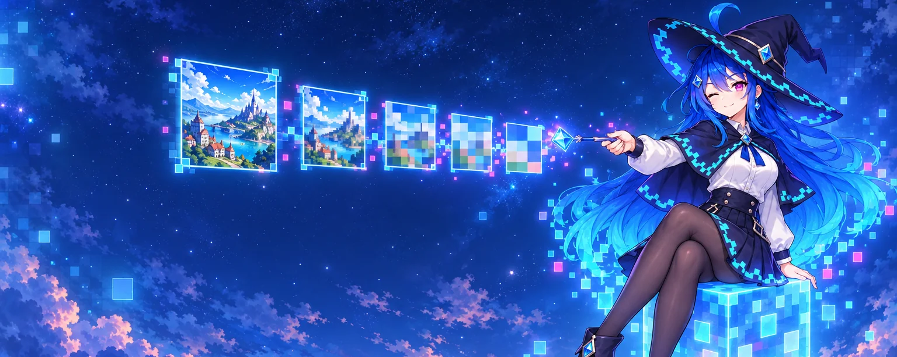

<p align="center">
  
</p>

<h1 align="center">Nani Pix</h1>

<p align="center">
  <b>Guess the anime from a pixelated screenshot: a Telegram game for your group chat.</b>
</p>

<p align="center">
  <a href="https://github.com/sm-steel/nani-pix-bot/actions/workflows/checks.yml"></a>
  <a href="https://github.com/sm-steel/nani-pix-bot/actions/workflows/tests.yml"></a>
  <a href="https://github.com/sm-steel/nani-pix-bot/releases"></a>
  <br>
  📖 <a href="https://sm-steel.github.io/nani-pix-bot/">Guide</a> ·
  🎮 <a href="https://sm-steel.github.io/nani-pix-bot/players/how-to-play/">How to play</a> ·
  🐳 <a href="https://sm-steel.github.io/nani-pix-bot/self-hosting/">Self-hosting</a>
</p>

## How to play

Someone picks a screenshot (their own, or one Nani Pix finds on Shikimori,
Tenrai or TMDB) and tells her which anime it is. She posts it heavily
pixelated in your group's game topic, and everyone races to `/guess` the
title. The picture gets sharper as wrong guesses pile up, over five stages,
until someone gets it or she reveals the answer.

## Features

- 🎯 **Forgiving guesses**: case, punctuation, season numbers and small typos don't matter, and alternative titles count
- 🎬 **Animated reveal**: the picture sharpens into a short video that ends with the winner's badge
- 💠 **Currency and clue shop**: earn pixels for playing, spend them on a letter, the title's shape or an extra screenshot
- 🔥 **HARD MODE**: games Nani Pix starts herself show two screenshots at once
- 🏆 **Achievements and champions**: titles to unlock, weekly, monthly and yearly winners
- 📊 **Leaderboards, history and profiles** for every player
- 🌐 **English and Russian**
- …and many more, [see the guide](https://sm-steel.github.io/nani-pix-bot/)

## Self-hosting

Nani Pix runs as a Docker Compose stack. The
[self-hosting guide](https://sm-steel.github.io/nani-pix-bot/self-hosting/)
walks you through every step, from creating your Telegram bot to updating
her.

## Development

You need [uv](https://docs.astral.sh/uv/), [mise](https://mise.jdx.dev/) and
Docker.

```sh
git clone https://github.com/sm-steel/nani-pix-bot && cd nani-pix-bot
mise install                # pinned uv, qlty, ffmpeg and Node
uv sync
uv run pre-commit install
uv run pytest
```

To run your own Nani Pix, create a test bot with
[@BotFather](https://t.me/BotFather), then `cp .env.example .env`, fill it in
and run `docker compose up --build`. The game rules are in
[MECHANICS.md](MECHANICS.md), the code's layout in
[ARCHITECTURE.md](ARCHITECTURE.md), and the conventions in
[CLAUDE.md](CLAUDE.md).

## License

[MIT](LICENSE), the Nani Pix artwork included.
